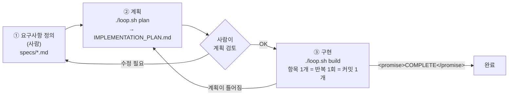
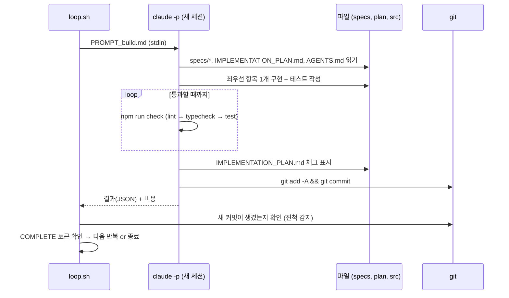

# Ralph Loop PoC — TODO 웹 서비스

랄프 루프(Ralph Loop)로 TODO 웹 서비스를 **에이전트가 스스로 반복 개발**하게 만드는 개발환경입니다.
이 저장소의 목적은 프로덕션 도입 전 **PoC(개념 검증)** 이며, 현재 상태는 **개발환경 세팅까지만 완료**된 상태입니다.
서비스 코드(`src/`, `public/`)는 아직 한 줄도 없습니다. 그것을 만드는 것이 랄프 루프의 몫입니다.

---

## 목차

1. [랄프 루프란?](#1-랄프-루프란)
2. [이 환경의 구조](#2-이-환경의-구조)
3. [사전 요구사항](#3-사전-요구사항)
4. [세팅 과정 상세 (무엇을, 왜 했는가)](#4-세팅-과정-상세-무엇을-왜-했는가)
5. [실행 방법](#5-실행-방법)
6. [안전장치](#6-안전장치)
7. [루프가 엇나갈 때 — 튜닝 가이드](#7-루프가-엇나갈-때--튜닝-가이드)
8. [PoC 평가 체크리스트](#8-poc-평가-체크리스트)
9. [프로덕션 적용 시 고려사항](#9-프로덕션-적용-시-고려사항)
10. [트러블슈팅](#10-트러블슈팅)
11. [참고 자료](#11-참고-자료)

---

## 1. 랄프 루프란?

Geoffrey Huntley가 제안한 기법으로, 가장 순수한 형태는 아래 한 줄입니다.

```bash
while :; do cat PROMPT.md | claude -p ; done
```

**같은 프롬프트를 매번 새로운(빈) 컨텍스트의 에이전트에게 반복해서 주는 것**이 전부입니다.
이름은 『심슨 가족』의 랄프 위검에서 왔습니다. 똑똑하진 않지만 지치지 않고 계속 시도하는 캐릭터죠.
단순해 보이지만 다음 원칙들이 결합되면서 강력해집니다.

| 원칙 | 의미 | 이 저장소에서의 구현 |
| --- | --- | --- |
| **매 반복마다 새 컨텍스트** | 긴 대화로 컨텍스트가 오염·압축되면 품질이 떨어집니다. 매번 새로 시작해 항상 "똑똑한 구간"에서 일하게 합니다. | `loop.sh`가 매 반복마다 `claude -p`를 새로 실행 |
| **결정적인 컨텍스트 적재** | 매 반복 시작 시 같은 파일(스펙·계획·운영 가이드)을 읽게 해서, 기억이 없어도 같은 출발점에 서게 합니다. | `PROMPT_*.md`의 `0a~0d` 단계, `CLAUDE.md → AGENTS.md` |
| **반복당 한 가지 일** | 한 번에 하나의 계획 항목만 구현·검증·커밋합니다. 작게 쪼갤수록 실패 반경이 작아집니다. | `PROMPT_build.md` 1단계 |
| **백프레셔(Backpressure)** | 린트·타입검사·테스트가 잘못된 결과를 거부해 에이전트를 올바른 방향으로 "밀어냅니다". | `npm run check` = Biome + `tsc` + Vitest |
| **파일이 곧 기억** | 반복 간 상태는 대화가 아니라 파일(`IMPLEMENTATION_PLAN.md`)과 git 히스토리에 남깁니다. | 계획 파일 + 반복마다 커밋 |
| **계획은 버려도 된다** | 계획이 틀어지면 고치려 애쓰지 말고 `plan` 모드로 다시 생성합니다. | `./loop.sh plan` |
| **표지판 세우기** | 랄프가 같은 실수를 반복하면 프롬프트에 "표지판"(지시)을 추가해 튜닝합니다. | [7장](#7-루프가-엇나갈-때--튜닝-가이드) |

### 세 단계 워크플로



1. **요구사항 정의 (사람)** — 무엇을 만들지 `specs/`에 적습니다. 이 저장소에는 이미 작성되어 있습니다.
2. **계획 (`plan` 모드)** — 에이전트가 스펙과 현재 코드를 비교해 우선순위가 매겨진 체크리스트를 만듭니다. **코드는 작성하지 않습니다.**
3. **구현 (`build` 모드)** — 매 반복마다 가장 중요한 항목 하나를 구현 → `npm run check` 통과 → 계획 갱신 → 커밋합니다.

### 한 번의 build 반복 안에서 일어나는 일



---

## 2. 이 환경의 구조

```
loop-engineering/
├── README.md                  # 이 문서
├── loop.sh                    # ★ 랄프 루프 실행기 (plan / build 모드)
├── stop.sh                    # 그레이스풀 셧다운: 현재 반복이 끝나면 루프 종료
├── PROMPT_plan.md             # ★ plan 모드 프롬프트 — 계획만 세움
├── PROMPT_build.md            # ★ build 모드 프롬프트 — 항목 1개 구현·검증·커밋
├── IMPLEMENTATION_PLAN.md     # ★ 반복 간 공유되는 "기억" (현재는 비어 있음)
├── AGENTS.md                  # ★ 운영 가이드: 빌드·실행·테스트 방법, 학습한 주의점
├── CLAUDE.md                  # `@AGENTS.md` 한 줄 — Claude Code가 AGENTS.md를 자동 로드하게 함
├── specs/                     # ★ 요구사항 (사람 소유, 에이전트는 읽기 전용)
│   ├── 00-overview.md         #   비전·범위·완료 정의
│   ├── 01-todo-api.md         #   REST API·데이터 모델·수용 기준 AC-API-*
│   ├── 02-web-ui.md           #   웹 UI·수용 기준 AC-UI-*
│   └── 03-tech-stack.md       #   고정 기술 스택·코드 구조·품질 기준
├── scripts/
│   └── pretty.jq              # stream-json 로그를 사람이 읽기 좋게 변환
├── tests/
│   └── toolchain.smoke.test.ts# 환경 자체 검증 테스트 (Node 24, node:sqlite)
├── .claude/settings.json      # 에이전트 권한 허용/거부 목록
├── .ralph/logs/               # 반복별 원본 로그 (*.jsonl, git 미추적)
├── package.json               # 스크립트: check / lint / typecheck / test / start / dev
├── tsconfig.json              # strict + Node type stripping 호환 설정
├── vitest.config.ts           # 테스트 시 DB_PATH=':memory:'
├── biome.json                 # 린트·포맷 규칙
└── .gitignore
```

### 파일 소유권 — 누가 무엇을 고치는가

| 파일 | 사람 | 에이전트 | 비고 |
| --- | --- | --- | --- |
| `specs/*` | ✏️ 작성 | 👀 읽기만 | 권한 설정으로 수정 차단 |
| `PROMPT_*.md`, `loop.sh`, `stop.sh`, `scripts/`, `.claude/`, `README.md` | ✏️ 튜닝 | 👀 읽기만 | 권한 설정으로 수정 차단 |
| `IMPLEMENTATION_PLAN.md` | 👀 검토 | ✏️ 생성·갱신 | 틀어지면 지우고 재생성 |
| `AGENTS.md` | ✏️ 초기 작성 | ✏️ 학습 내용 추가 | 운영 정보만, 짧게 유지 |
| `src/`, `public/`, `tests/` | 👀 리뷰 | ✏️ 구현 | |

---

## 3. 사전 요구사항

세팅 시점(2026-11-02)에 확인한 버전입니다.

| 도구 | 확인 버전 | 용도 |
| --- | --- | --- |
| macOS | Darwin 27 | |
| Node.js | v24.17.0 | 런타임 (`.ts` 직접 실행, `node:sqlite` 내장) |
| npm | 11.13.0 | 패키지 관리 |
| git | 2.54.0 | 반복별 커밋·롤백 |
| jq | 설치됨 | 로그 파싱 (`loop.sh`, `pretty.jq`) |
| Claude Code CLI | 2.1.193 | 에이전트 (`claude -p`) |

```bash
node -v && npm -v && git --version && jq --version && claude --version
```

Claude Code에 로그인되어 있어야 합니다 (`claude` 실행 후 `/login`, 또는 `ANTHROPIC_API_KEY`).

---

## 4. 세팅 과정 상세 (무엇을, 왜 했는가)

아래는 이 저장소를 만들 때 실제로 수행한 과정입니다. 새 프로젝트에 같은 환경을 재현할 때 그대로 따라 하면 됩니다.

### 4.1 저장소 초기화

```bash
git init -b main
mkdir -p specs scripts tests .claude .ralph/logs
touch .ralph/logs/.gitkeep
```

**왜?** 랄프 루프에서 git은 필수입니다. 반복마다 커밋이 쌓여야 ① 진척을 감지하고 ② 나쁜 반복을 `git reset`으로 되돌릴 수 있습니다.

### 4.2 요구사항 작성 — `specs/`

TODO 서비스를 주제(topic)별로 나눠 4개 문서로 작성했습니다.

- **각 요구사항에 ID가 붙은 수용 기준(`AC-API-3` 등)** 을 두었습니다. 계획 항목과 커밋 메시지가 이 ID를 참조하게 되어, 사람이 진척을 추적하기 쉽고 에이전트가 "완료"를 객관적으로 판단할 수 있습니다.
- **범위 밖(Out of scope)** 을 명시했습니다. 랄프는 시키지 않은 기능도 "좋아 보이면" 만들기 때문입니다.
- **기술 스택을 고정**했습니다(`03-tech-stack.md`). 스택이 열려 있으면 반복마다 다른 선택을 하며 코드가 흔들립니다.

선택한 스택과 그 이유:

| 선택 | 이유 |
| --- | --- |
| Node 24 type stripping (`node src/server.ts`) | 빌드 단계가 없어 에이전트가 실수할 지점이 줄어듦 |
| `node:sqlite` (내장) | 네이티브 모듈 컴파일 실패 같은 환경 문제를 원천 제거 |
| Fastify + `app.inject()` | 포트를 열지 않고 API를 테스트 → 빠르고 결정적인 백프레셔 |
| 바닐라 JS UI | 프레임워크·번들러 설정에 반복을 낭비하지 않음 |

### 4.3 프롬프트 작성 — `PROMPT_plan.md`, `PROMPT_build.md`

Huntley의 플레이북 구조를 이 프로젝트에 맞게 다듬었습니다. 프롬프트는 영어로 썼습니다(지시 키워드의 해석이 가장 안정적이며, 스펙은 한국어여도 문제없습니다).

**공통 구조**

| 구간 | 내용 | 목적 |
| --- | --- | --- |
| `0a~0d` | `specs/*`, 계획, 코드를 **서브에이전트로** 읽기 | 메인 컨텍스트를 아끼면서 매번 같은 출발점에 서기 |
| `1~5` | 실제 작업 지시 | |
| `999…` | 숫자가 클수록 중요한 불변 규칙 | 긴 프롬프트에서도 핵심 규칙이 묻히지 않게 |

**`PROMPT_plan.md`의 핵심 지시**

- "구현하지 말고 계획만 세워라. 쓸 수 있는 파일은 `IMPLEMENTATION_PLAN.md`뿐이다."
- "**없다고 가정하지 마라.** 코드 검색으로 확인하라." — 랄프의 가장 흔한 실패(이미 있는 기능을 중복 구현)를 막는 표지판입니다.
- 항목은 **한 번의 반복에서 끝낼 수 있는 크기**로, 기반 작업(앱 팩토리·영속성)을 먼저.

**`PROMPT_build.md`의 핵심 지시**

- 가장 중요한 미완료 항목 **하나만** 선택 → 구현 + 테스트 → `npm run check` 통과까지 수정 → 계획 갱신 → 커밋(푸시 금지).
- 빌드·테스트 실행은 **서브에이전트 1개만** — 병렬 테스트 실행이 서로 충돌하는 것을 방지.
- 테스트를 건너뛰거나 약화시키지 말 것, 플레이스홀더 금지, 스펙·프롬프트 수정 금지.
- 모든 항목이 끝나고 검증되면 `<promise>COMPLETE</promise>`를 출력 → `loop.sh`가 이를 감지해 종료.

### 4.4 운영 가이드 — `AGENTS.md` + `CLAUDE.md`

`AGENTS.md`에는 **빌드·실행·테스트 방법만** 짧게 적습니다. 매 반복마다 컨텍스트에 실리므로 길어지면 그만큼 비용과 품질 손해입니다.
Claude Code는 `CLAUDE.md`를 자동으로 읽으므로, `CLAUDE.md`에 `@AGENTS.md` 한 줄을 두어 자동 로드되게 했습니다.
에이전트가 새로 알게 된 명령이나 함정은 `## Operational Notes`에 스스로 추가합니다.

### 4.5 백프레셔 툴체인

```bash
npm install -D typescript vitest @biomejs/biome @types/node@^24
```

| 스크립트 | 실행 내용 |
| --- | --- |
| `npm run lint` | `biome check .` — 린트 + 포맷 검사 (`*.md`는 제외) |
| `npm run typecheck` | `tsc --noEmit` — strict, `erasableSyntaxOnly`(Node type stripping 호환) |
| `npm test` | `vitest run` — 테스트 중 `DB_PATH=':memory:'` |
| **`npm run check`** | 위 세 가지를 순서대로. **에이전트가 커밋 전에 반드시 통과시켜야 하는 관문** |

**왜 앱 의존성(fastify)은 설치하지 않았나?** 앱 의존성 설치는 서비스 구현의 일부이므로 랄프에게 맡겼습니다. 여기서는 "검증하는 도구"만 준비했습니다.

`tests/toolchain.smoke.test.ts`는 앱이 아니라 **환경 자체**를 검증합니다(Node ≥ 24, `node:sqlite` 동작, 테스트 DB가 메모리인지). `tsc`와 `vitest`는 입력 파일이 하나도 없으면 실패하기 때문에, 이 테스트가 있어야 빈 저장소에서도 `npm run check`가 통과합니다.

검증 결과:

```
$ npm run check
biome check .   → Checked 5 files. No fixes applied.
tsc --noEmit    → (오류 없음)
vitest run      → Test Files 1 passed (1) · Tests 3 passed (3)
```

타입 오류가 있는 파일을 일부러 넣었을 때 `typecheck`가 실패하는 것도 확인했습니다(백프레셔가 실제로 작동함).

### 4.6 루프 실행기 — `loop.sh`

순수한 `while` 한 줄에 PoC에 필요한 관측성과 안전장치를 더했습니다.

| 기능 | 동작 |
| --- | --- |
| 모드 | `plan`(기본 1회) / `build`(기본 10회, `0`=무제한) |
| 모드별 모델 | plan은 메인·서브 모두 Opus(판단 품질 우선), build는 메인·서브 모두 Haiku(PoC 비용 최소화) |
| 새 컨텍스트 | 매 반복마다 `claude -p --output-format stream-json --verbose`를 새로 실행 |
| 권한 | 기본 `--permission-mode dontAsk` → `.claude/settings.json` 허용 목록 밖의 도구는 **묻지 않고 거부** |
| 실시간 로그 | `scripts/pretty.jq`로 💬 메시지 · 🔧 도구 호출 · 🏁 반복 요약(턴 수·시간·비용) 출력 |
| 원본 로그 | `.ralph/logs/<시각>-<모드>-<번호>.jsonl`에 전체 이벤트 저장 |
| 완료 감지 | 결과에 `<promise>COMPLETE</promise>`가 있으면 종료 |
| 진척 감지(서킷 브레이커) | build 모드에서 새 커밋 없는 반복이 연속 3회면 종료 (exit 2) |
| 실패 재시도 | `claude`가 비정상 종료하면 30s·60s 대기 후 재시도, 연속 3회 실패 시 종료 |
| 비용 집계 | 반복별 `total_cost_usd`를 합산해 마지막에 출력 |
| 우아한 중단 | `./stop.sh`(또는 `touch .ralph/STOP`) → 현재 반복이 끝난 뒤 종료. 자세한 내용은 [5.4](#54-관찰중단롤백) |
| 사전 점검 | `claude`/`jq`/`git`/`npm` 존재, 프롬프트 파일, **최소 1개의 커밋** 확인 |

환경 변수:

| 변수 | 기본값 | 설명 |
| --- | --- | --- |
| `RALPH_MODEL` | plan=`opus`, build=`haiku` | 메인 에이전트 모델 (별칭 또는 전체 이름). `--model`로 전달 |
| `RALPH_SUBAGENT_MODEL` | 메인 에이전트와 동일 | 서브에이전트 모델. `CLAUDE_CODE_SUBAGENT_MODEL` 환경 변수로 전달 |
| `RALPH_BUDGET_USD` | (없음) | 반복당 지출 상한 (`--max-budget-usd`) |
| `RALPH_MAX_NO_PROGRESS` | `3` | 서킷 브레이커 임계값 |
| `RALPH_YOLO` | `0` | `1`이면 `--dangerously-skip-permissions` — **격리된 컨테이너에서만** |
| `RALPH_PUSH` | `0` | `1`이면 반복마다 `git push` |

`loop.sh` 자체의 동작은 가짜 `claude` 바이너리로 토큰을 쓰지 않고 검증했습니다: 커밋 없음 거부, 3회차 COMPLETE 감지·종료, 무진척 3회 후 exit 2, plan 기본 1회 제한, STOP 파일 중단, 비용 합산.

### 4.7 권한 설정 — `.claude/settings.json`

헤드리스 루프에서는 권한 프롬프트에 답할 사람이 없습니다. 선택지는 두 가지입니다.

1. `--dangerously-skip-permissions` — 모든 것을 허용. 격리된 샌드박스 전용.
2. **`--permission-mode dontAsk` + 허용 목록** — 이 저장소의 기본값. 로컬 Mac에서 PoC 하기에 안전한 쪽입니다.

- **허용**: 파일 읽기/쓰기, 서브에이전트, `npm install/run/test`, `npx vitest/tsc/biome`, `node`, 읽기 계열 git + `git add/commit`, `src|tests|public` 안에서의 `rm`, `localhost` 대상 `curl`
- **거부**: `git push/reset/checkout/rebase/clean`, `sudo`, `npm publish`, `.env` 읽기, 웹 검색·페치, 그리고 **`specs/`, `PROMPT_*.md`, `loop.sh`, `stop.sh`, `scripts/`, `.claude/`, `README.md` 수정**

> 에이전트가 스스로 스펙이나 프롬프트를 고쳐 "기준을 낮추는" 것을 막는 것이 핵심입니다.

---

## 5. 실행 방법

### 5.0 권한 설정이 실제로 적용되는지 확인 (최초 1회, 권장)

세팅 중 이 검증은 수행하지 못했습니다(실행 승인을 받지 못함). 루프를 돌리기 전에 직접 확인하세요.
저렴한 모델로 4가지 동작을 시도하게 하고 결과를 봅니다(비용 ≈ 수 센트).

```bash
claude -p --permission-mode dontAsk --model haiku --max-budget-usd 0.5 "Do exactly these steps, one tool call each, then report a table of step -> ALLOWED or DENIED. Do not retry or work around denials. 1) Bash: git status --short 2) Bash: git push origin main 3) Write specs/probe.md with 'x' 4) Write src/probe.txt with 'x'"
```

기대 결과: `1 ALLOWED · 2 DENIED · 3 DENIED · 4 ALLOWED`. 확인 후 정리합니다.

```bash
rm -rf src specs/probe.md
```

> `.claude/settings.json`이 검증에 실패하면 **헤드리스 모드에서는 오류 없이 무시**됩니다. 이때 `dontAsk`는 거의 모든 도구를 거부하므로, 루프가 아무 일도 못 하고 서킷 브레이커로 멈추는 증상으로 나타납니다.

### 5.1 기준선 커밋 (Baseline commit)

`loop.sh`는 커밋이 하나도 없으면 실행을 거부합니다(진척 감지와 롤백의 기준점).

```bash
git add -A && git commit -m "chore: set up Ralph loop environment"
```

### 5.2 계획 수립

```bash
./loop.sh plan
```

끝나면 `IMPLEMENTATION_PLAN.md`를 **사람이 검토**합니다.

- 항목이 한 반복에 끝낼 만큼 작은가? 순서(기반 → 기능)가 맞는가?
- 모든 `AC-*`가 어떤 항목에 매핑되어 있는가?
- `Open questions`가 있다면 `specs/`를 보완하고 `./loop.sh plan`을 다시 실행합니다.

만족하면 계획을 커밋합니다.

```bash
git add IMPLEMENTATION_PLAN.md && git commit -m "plan: initial implementation plan"
```

### 5.3 구현 루프

처음에는 **짧게, 지켜보면서** 돌리는 것을 권장합니다.

```bash
./loop.sh build 3
```

괜찮으면 반복 횟수와 예산을 늘립니다.

```bash
RALPH_BUDGET_USD=3 ./loop.sh build 20
```

### 5.4 관찰·중단·롤백

| 하고 싶은 것 | 방법 |
| --- | --- |
| 진척 보기 | `git log --oneline` · `IMPLEMENTATION_PLAN.md` |
| 지금 반복이 끝나면 멈추기 | `./stop.sh` (다른 터미널에서. `touch .ralph/STOP`과 같음) |
| 멈추기 + 종료될 때까지 기다리기 | `./stop.sh --wait` (기본 최대 30분, `RALPH_STOP_TIMEOUT`으로 조정) |
| 중단 요청 취소 | `./stop.sh --cancel` |
| 루프 실행·중단 요청 상태 보기 | `./stop.sh --status` |
| 즉시 멈추기 | `Ctrl+C` (요약 출력 후 종료) |

**중단 방법 비교**

| | `./stop.sh` (권장) | `Ctrl+C` |
| --- | --- | --- |
| 멈추는 시점 | 현재 반복이 커밋까지 마친 뒤 | 즉시 (`claude`가 작업 도중 끊김) |
| 작업 트리 | 커밋된 깨끗한 상태 | 미완성 변경이 남을 수 있음 → `git status` 확인 후 `git stash push -u` |
| 비용 집계 | 정확함 | 중단된 반복은 빠짐 |

`stop.sh`는 이 저장소에서 실행 중인 `loop.sh`만 찾습니다(프로세스의 작업 폴더로 구분). 실행 중인 루프가 없으면 STOP 파일을 만들지 않고 종료 코드 1로 끝납니다. `loop.sh`가 시작할 때 남아 있는 STOP 파일을 지우므로, 미리 만들어 두는 것은 의미가 없습니다.
| 특정 반복의 상세 보기 | `jq -Rrj -f scripts/pretty.jq .ralph/logs/<파일>.jsonl` |
| 반복별 비용 보기 | `jq -r 'select(.type=="result") \| "\(input_filename) $\(.total_cost_usd)"' .ralph/logs/*.jsonl` |
| 나쁜 반복 되돌리기 | `git reset --hard <좋았던 커밋>` (사람만 가능, 에이전트는 차단됨) |
| 앱 실행해 보기 | `npm start` → http://127.0.0.1:3000 |

---

## 6. 안전장치

| 위험 | 대응 |
| --- | --- |
| 파괴적 명령 실행 | `dontAsk` + 허용 목록. 목록 밖의 명령은 거부 |
| 원격 저장소 오염 | `git push` 거부, `RALPH_PUSH` 기본 꺼짐 |
| 기준 낮추기(스펙·테스트 조작) | 스펙/프롬프트 수정 거부 + 프롬프트의 "테스트 약화 금지" 규칙 + 사람 리뷰 |
| 무한 루프·비용 폭주 | 기본 반복 상한(plan 1, build 10), `RALPH_BUDGET_USD`, 무진척 서킷 브레이커 |
| 비밀 정보 노출 | `.env` 읽기 거부, `.gitignore`, 웹 페치 거부 |
| 같은 작업 무한 반복 | 커밋 없는 반복 3회 연속 시 종료 → 사람이 로그 확인 |

`RALPH_YOLO=1`(권한 우회)은 네트워크가 제한된 Docker 컨테이너나 VM 같은 **격리 환경에서만** 쓰세요. 로컬 Mac에서는 기본 모드를 유지하는 것을 권장합니다.

---

## 7. 루프가 엇나갈 때 — 튜닝 가이드

랄프 루프의 운영은 "코드를 고치는 것"이 아니라 **"루프를 고치는 것"** 입니다. 증상을 보고 표지판(프롬프트·스펙·운영 가이드)을 추가하세요.

| 증상 | 원인 추정 | 조치 |
| --- | --- | --- |
| 이미 있는 기능을 다시 만든다 | 코드 검색 없이 "없다"고 가정 | 프롬프트의 "don't assume not implemented" 강조, `AGENTS.md`에 모듈 위치 명시 |
| 한 반복에 여러 항목을 건드린다 | 항목이 너무 크거나 모호 | 계획을 지우고 `./loop.sh plan` 재실행, 항목 크기 지시 강화 |
| 테스트를 지우거나 `skip` 한다 | 백프레셔 회피 | 규칙 강화, 필요하면 커밋 전 훅으로 `skip` 탐지 |
| 같은 빌드 오류로 맴돈다 | 운영 지식 부족 | 해결 방법을 `AGENTS.md`에 직접 추가 |
| 스펙에 없는 기능을 만든다 | 범위가 모호 | `specs/00-overview.md`의 Out of scope 보강 |
| 계획 파일이 비대해진다 | 정리 부족 | 지우고 재생성 (계획은 버려도 되는 것) |
| 아무 일도 못 하고 멈춘다 | 권한 거부 | 로그에서 거부된 도구 확인 → `.claude/settings.json` 허용 목록 보강 |

거부된 도구는 로그의 마지막 `result` 이벤트에서 확인할 수 있습니다.

```bash
jq -r 'select(.type=="result") | .permission_denials[]? | "\(.tool_name) \(.tool_input.command // .tool_input.file_path)"' .ralph/logs/*.jsonl | sort | uniq -c
```

### 컨텍스트 관련 참고

Claude Code는 매 반복마다 **사용자 전역 설정(`~/.claude/CLAUDE.md` 등)** 도 함께 읽습니다. 전역 설정이 크면 반복마다 컨텍스트를 그만큼 소모합니다.
PoC 측정의 정확도를 위해, 전역 설정 없이 돌린 결과와 비교해 보는 것을 권장합니다.
`--bare` 옵션은 `CLAUDE.md` 자동 탐색 등을 건너뛰지만 `ANTHROPIC_API_KEY` 인증만 지원하고 `AGENTS.md` 자동 로드도 사라지므로, 쓰려면 `loop.sh`의 `CLAUDE_ARGS`에 `--bare --append-system-prompt-file AGENTS.md`처럼 직접 넣어야 합니다.

---

## 8. PoC 평가 체크리스트

프로덕션 도입 판단을 위해 루프를 돌리면서 다음을 기록하세요.

**정량 지표**

- [ ] 완료까지 걸린 반복 수 / 총 소요 시간 / 총 비용 (`loop.sh` 요약)
- [ ] 반복당 평균 비용·턴 수 (`.ralph/logs/*.jsonl`의 `result` 이벤트)
- [ ] 무진척 반복 비율 (서킷 브레이커 발동 횟수)
- [ ] 사람이 개입한 횟수와 이유 (스펙 수정, 프롬프트 튜닝, 롤백)
- [ ] 수용 기준 `AC-*` 충족률

**정성 평가**

- [ ] 생성된 코드를 사람이 유지보수할 수 있는 품질인가 (구조, 명명, 중복)
- [ ] 테스트가 실제로 의미 있는 것을 검증하는가 (구현을 그대로 베낀 테스트는 아닌가)
- [ ] 커밋 히스토리가 리뷰 가능한 단위로 쪼개져 있는가
- [ ] 권한 거부·안전장치가 실제 위험을 막았는가

**권장 실험**

- 같은 스펙으로 build 모델을 바꿔 비교 (기본 `haiku` vs `RALPH_MODEL=sonnet ./loop.sh build` vs `RALPH_MODEL=opus ./loop.sh build`)
- 계획 없이 build만 돌렸을 때와 비교
- 스펙에 기능을 하나 추가하고 `plan → build`로 증분 개발이 되는지 확인

---

## 9. 프로덕션 적용 시 고려사항

| 영역 | PoC (현재) | 프로덕션 권장 |
| --- | --- | --- |
| 실행 환경 | 로컬 Mac, `dontAsk` 허용 목록 | 네트워크가 제한된 컨테이너/VM, 전용 계정·토큰 |
| 브랜치 전략 | `main`에 직접 커밋 | 전용 브랜치 또는 `git worktree`, 결과는 PR로 사람 리뷰 |
| 검증 | lint + typecheck + 단위/통합 테스트 | + E2E(Playwright), 보안 스캔, 커버리지 기준, CI 재검증 |
| 비용 통제 | 반복 상한 + 반복당 예산 | 일·프로젝트 단위 예산, 알림 |
| 관측성 | 로컬 jsonl 로그 | 중앙 로그 수집, 반복별 지표 대시보드 |
| 비밀 관리 | `.env` 읽기 거부 | 에이전트 환경에 비밀 자체를 두지 않음 |
| 대안 비교 | bash 루프 | Claude Code의 Stop 훅 기반 플러그인 방식과 비교 검토 (같은 세션을 이어가므로 "반복마다 새 컨텍스트" 원칙과 차이가 있음) |

---

## 10. 트러블슈팅

| 증상 | 해결 |
| --- | --- |
| `error: no git commit yet` | [5.1 기준선 커밋](#51-기준선-커밋-baseline-commit) 수행 |
| `error: 'jq' not found` | `brew install jq` |
| 매 반복이 즉시 끝나고 아무 변화 없음 | 인증 확인(`claude` 실행해 로그인), 권한 거부 확인([7장](#7-루프가-엇나갈-때--튜닝-가이드)의 `permission_denials` 명령) |
| `npm run check`가 `*.md` 포맷으로 실패 | `biome.json`의 `files.includes`에 `!**/*.md`가 있는지 확인 |
| `node src/server.ts`에서 문법 오류 | `enum`/`namespace`/parameter property 사용 여부 확인 (Node type stripping 비호환) |
| 루프 실행 권한 오류 | `chmod +x loop.sh` |

---

## 11. 참고 자료

- Geoffrey Huntley, *Ralph Wiggum as a "software engineer"* — https://ghuntley.com/ralph/
- Claude Code 헤드리스 모드 — https://docs.claude.com/en/docs/claude-code/headless
- Claude Code 권한 설정 — https://docs.claude.com/en/docs/claude-code/iam
- Node.js TypeScript 실행 (type stripping) — https://nodejs.org/api/typescript.html
